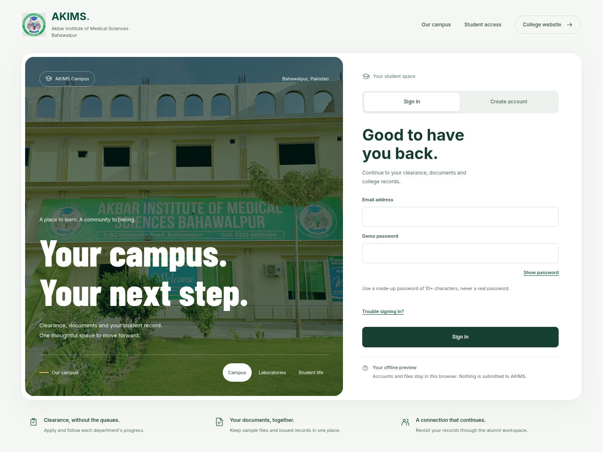

# AKIMS Campus · Simple edition

A plain **HTML, CSS and JavaScript** demonstration of the AKIMS clearance portal. Download, extract and double-click **index.html**. No build, Node.js, terminal, server or database installation is required to view this edition.

**[Download this edition](https://github.com/TheMughees1/AKIMS-Mega-Project/archive/refs/heads/akims-simple.zip)** · [Roman Urdu instructions](START-HERE.txt)

[Premium design and review](PREMIUM-DESIGN.md) · [Applied modern design skill](MODERN-DESIGN.md) · [Validation and known limits](VALIDATION.md)

The premium revision pairs real campus photography and bold kinetic type with a working sign-in panel. Student home gives clearance its own focused workspace, an actual departmental completion ring and a personal document desk. Campus photographs can be switched manually or opened with the keyboard; reduced-motion preferences are respected.



[Student dashboard preview](assets/previews/student.png) · [Mobile preview](assets/previews/mobile.png)

## Open it

1. Download the ZIP from the **akims-simple** branch.
2. Extract the complete ZIP into a folder.
3. Open **index.html** in a current Chrome, Edge or Firefox browser.
4. Choose **Create account**, enter fictional student details and a made-up password, then sign in. Or use **Explore demonstration workspaces** below the campus photographs to try the sample roles.
5. In **My documents**, add a sample PDF/JPEG/PNG file, preview images, download or remove it. New registrations can submit their own clearance request; Administration can review it in the same browser.

In VS Code, use **File → Open Folder**, select the extracted folder and edit the files. Refresh the browser after saving. Live Server is optional; opening the file directly is supported.

## Understand the files

```text
AKIMS-Portal/
├── index.html            Page shell
├── style.css             Visual design, responsive layouts and printing
├── script.js             Screens, forms, imports and user interactions
├── assets/
│   ├── data.js           Fictional data, browser storage and workflow rules
│   ├── portal.js         Local password verifiers and document storage
│   ├── images/           College logo and photographs
│   └── fonts/            Local fonts and their licenses
├── START-HERE.txt        Beginner instructions in Roman Urdu
└── README.md             This guide
```

There are no network-loaded frameworks or fonts. Sample data is loaded with a regular script tag so the application works under `file://` without fetching a JSON file. To change the starting examples, edit the `seed` in `assets/data.js`, save and choose **Reset demo** in the portal. Reset replaces current demo changes.

## Demonstrate a complete clearance

- **Student:** submit a clearance application and see departmental progress.
- **Staff:** review the assigned Anatomy laboratory and manage its sample stock.
- **Administration:** assess departments; record an investigation or confirmed charge; resolve a return or authorized sample waiver; issue a challan after assessment.
- **Student:** preview the watermarked challan and submit sample receipt details.
- **Accounts:** return a sample receipt for correction or enter the exact sample reference and amount to verify it.
- **Administration:** complete remaining departmental clearance and authorize the certificate. Unresolved issues and unpaid dues block authorization.
- **Student:** view the certificate and use **Print / Save PDF**. Revoked certificates remain identifiable as revoked in the current demo data.

A no-dues request goes directly from departmental clearance to final authorization. Duplicate active requests and premature approvals are rejected. Issued challan amounts and issued certificate identity snapshots are preserved. Correction, resubmission and revocation remain part of the history.

Additional screens cover inventory movements, student search, previewed CSV import, reports, audit history, assigned class observations and alumni profile/documents. CSV import uses explicit column mapping and rejects conflicts rather than overwriting students. Full LMS and anonymous survey collection are future work.

## What is stored

This is a **single-browser demonstration**, with fictional people and illustrative policies. Browser storage retains changes when available. If storage is blocked, the app reports that changes only last in the current tab. Moving the folder, using another browser, clearing browser data or switching between a file and a hosted address can change which saved demo is available. Keep one working tab open to avoid competing edits.

**Export demo data** in Administration saves a readable JSON copy, excluding local account password verifiers and uploaded files; an automatic restore feature is not included. Download each personal document separately to keep a copy. Receipt selection records sample file metadata and a sample reference, not the file's contents. Print dialogs can save a PDF through the browser; the app does not send documents to a bank or issue official certificates.

Role switching and browser-side checks illustrate permissions; they are **not secure authentication**. This edition is not suitable for actual student records, passwords, bank information, payments or official approvals. Everything in a publicly hosted assets folder is downloadable by visitors. Do not place private institutional files there.

## Hosting later

Upload this folder's contents to a static website host, keeping all relative paths together. The `index.html` file is the entry point. The hosted demo still stores changes separately in each visitor's browser. A real multi-user college system needs a server, shared database, authenticated sessions, server-side authorization, private document storage and deployment controls. This interface can later connect to that backend.

The existing server-backed version remains on the separate **[akims-mvp branch](https://github.com/TheMughees1/AKIMS-Mega-Project/tree/akims-mvp)**. This branch is a standalone edition; none of that version's packages are needed here.

Fonts are bundled with their license notices in `assets/fonts`. The logo, campus photographs, brand colors and public contact information were sourced from akims.edu.pk. See [BRANDING.md](BRANDING.md) for exact sources and scope.

## Local student accounts and personal documents

This edition includes local sign-up, sign-in and sign-out. Passwords use per-account salts and PBKDF2-SHA256 (210,000 iterations); plaintext passwords are not saved. This does **not** turn a static site into secure authentication: all data and access checks remain in the browser, and the secondary demo role chooser intentionally bypasses sign-in. Use fictional details and a password not used elsewhere. Registration is self-declared, does not verify enrollment and never grants an administrative role. Forgotten-password email delivery is not available offline. The sign-in email is fixed even if profile contact email is changed.

Personal documents are actual file bytes in IndexedDB, scoped to the selected student's record. PDF/JPEG/PNG only, 5 MB each, at most 10 files and 25 MB per student. Filenames, MIME types and initial signatures are checked; this is not antivirus scanning. Image preview and individual downloads work locally; PDF viewing uses the downloaded copy in your PDF reader. Uploaded files have no institutional review/approval status. A receipt in My documents does not settle a challan; the existing Accounts workflow still verifies the separate sample receipt reference and amount.

Local accounts require working browser storage and Web Crypto; uploads require IndexedDB. If the browser restricts these for files, try a current Chrome/Edge or VS Code Live Server. Reset explicitly removes local accounts, personal uploads and workflow changes. Browser storage is not a backup and does not sync to other people or devices. Never upload real IDs or sensitive documents.

See [the access/design plan](DESIGN-REVISION.md) and [validation](VALIDATION.md).
